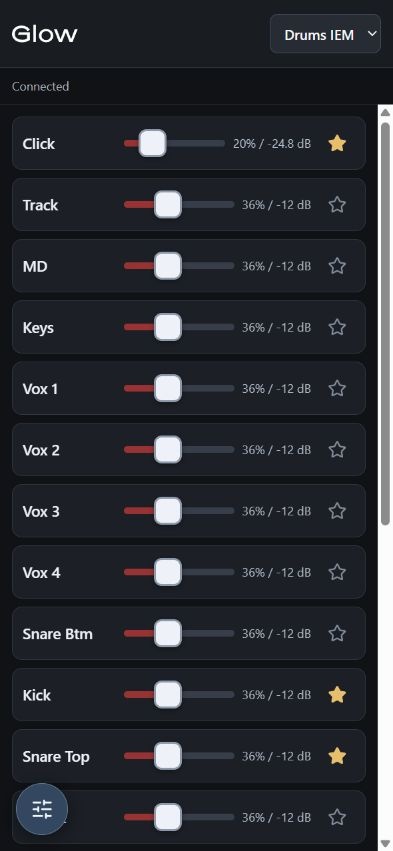
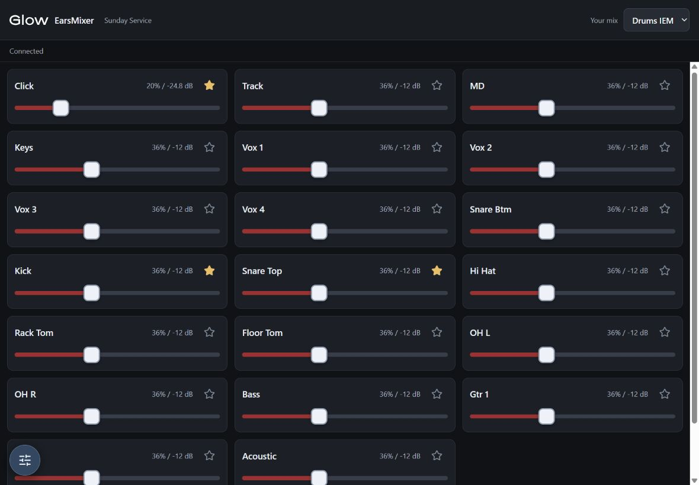
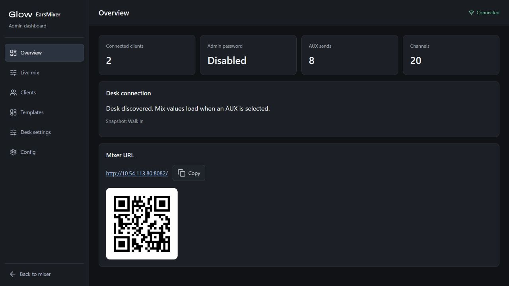

# EarsMixer

EarsMixer lets musicians control their own monitor mix from a phone, tablet or computer. It connects to DiGiCo SD Series and Quantum consoles and includes a browser-based mixer, an admin dashboard and a Windows service manager with a connection QR code.

## Install on Windows

**[Download the latest EarsMixer installer](https://github.com/joeclack/EarsMixer/releases/latest)**

1. Open the latest release and expand **Assets**.
2. Download `EarsMixer-<version>-windows-x64-setup.exe`. Choose the installer, rather than either **Source code** archive.
3. Run the installer and accept the Windows administrator prompt.
4. Leave **Show the EarsMixer tray icon when signing in** selected if you want the service manager available after each sign-in. A desktop shortcut is optional.
5. Open **EarsMixer tray** from the Start menu, or **EarsMixer Service Manager** from the desktop if you selected that shortcut.

The installer includes the runtime. You do not need Node.js, Git or a command prompt to use the installed app. The mixer starts after installation and runs automatically as a Windows service when the computer boots, including before sign-in.

### What you need

- Windows 10 version 1607 or later, or Windows 11, on an x64-compatible computer.
- Administrator permission to install and control the service.
- A DiGiCo SD Series or Quantum console. S-Series consoles are not supported.
- The server computer, console and mixer devices connected to the same network.

Set the server computer's mixer network to **Private** in Windows. The installer creates a firewall rule allowing devices on the local subnet to connect over a Private network.

## Connect your console

1. Right-click the EarsMixer tray icon and choose **Open admin dashboard**.
2. Open **Desk settings → Connection** in the dashboard.
3. On the console, open **Setup → External Control → DiGiCo iPad**. Set its outgoing destination to the server computer's network IP address and the server's OSC receive port, which defaults to UDP **8000**.
4. In EarsMixer, enter the console's IP address and its receive port, which defaults to UDP **9000**. Ensure the ports match the console's configuration, then save.
5. Select the channels and AUXes you want to make available to musicians and save the settings.
6. Double-click the tray icon to show the mixer QR code. Scan it on a device connected to the same network, then select an AUX to control its mix. The QR code is also available in the admin dashboard.

The default web port is **80**. The tray's browser links and QR code follow the configured port automatically. A link showing `127.0.0.1` means the server computer does not yet have a network address; connect it to the mixer network and the QR window will refresh.

If your network has a DNS name for the mixer, enter it in **Admin → Overview → Mixer URL → Custom URL** and click **Save URL**. For example, `ears.glow.uk` becomes `http://ears.glow.uk/`; you can also enter a full HTTPS URL or include a port, such as `http://ears.glow.uk:8082`. The mixer link and QR codes in the dashboard and tray use this saved address after restarts. DNS must already resolve the name to the server; a DNS record alone does not change the web port. Clear the field and save to return to the server address.

## Use the service manager

The tray icon appears in the notification area at the right of the Windows taskbar; it may be inside the hidden-icons menu.

- **Double-click** to show the QR code and copyable mixer link.
- **Right-click** for service status, Start/Stop/Restart, the mixer, admin dashboard, logs and settings.
- **Check for updates** checks GitHub for a newer Windows release. When available, **Download EarsMixer** opens its installer in your browser, and **View release notes** opens the release details.
- Service changes request administrator permission through Windows.
- Closing the QR window or choosing **Exit tray** leaves the mixer service running.

The service is named **EarsMixer** in Windows Services. It starts automatically with delayed startup and is configured to restart after a process failure.

## Mixer and admin dashboard

Musicians can choose list or grid views, reorder channels, save favourites and use compact or fullscreen controls. Layout preferences are saved per AUX on each browser/device.

**Phone mixer** — compact mode keeps channel names, faders and favourites on one row, with the controls menu in the bottom-left corner:



**iPad mixer** — landscape grid view shows channels side by side in three columns:



The admin dashboard provides connected-device status, activity history, a read-only live mix, channel/AUX configuration and starting templates for musicians. Templates save layout preferences, including channel order and favourites; loading one does not recall fader levels on the console.

The admin overview, showing connection status, client counts and the mixer QR code:



Screenshots use the offline demo with sample console data. The mixer is shown at phone (393 × 852) and iPad landscape (1180 × 820) viewport sizes.

To protect the dashboard, open **Admin → Config** and set an admin password of at least eight characters. Musicians can still access the mixer, and the tray QR code continues to work. Restarting the server clears admin sign-in sessions, so administrators will need to sign in again.

## Updates, settings and backups

The tray checks GitHub shortly after starting and every six hours while it is running. A newer stable Windows release produces a tray notification with an optional download. You can also choose **Check for updates** at any time. Checks run in the background; an offline mixer network does not interrupt the service or show automatic error dialogs. Updates are never installed automatically: download the installer and run it when you are ready for the service to restart. Closing the tray stops update checks while the mixer service keeps running.

Download and run the latest installer to update EarsMixer; you do not need to uninstall first. Setup reuses the previous installation folder, closes the tray, stops the service before replacing files and starts it again afterwards. Your settings, plugins, custom service XML and shortcut selections are retained. Running the same version again repairs the installation. The updated installer refuses to replace a newer installed version; installers released before this safeguard can still downgrade the app. If you are switching from an older console-based installation, stop that server with Ctrl+C first.

Saved files are in `%PROGRAMDATA%\EarsMixer`:

- `config/` — console connection, channel/AUX settings and shared desk presets.
- `data/` — musician templates and the admin password record.
- `plugins/` — optional custom plugins.
- `logs/` — server and service logs.

Upgrades and uninstall preserve these folders. To make a backup, stop the service from the tray, copy the EarsMixer data folder, then start the service again. Restoring files or adding plugins requires administrator permission.

The installer also migrates settings from earlier installations using the `OSCWebMixer2` folders, preserving the originals. Per-user settings are migrated from the account running setup; if you install using a different administrator account, copy the original user's settings manually.

## Troubleshooting

- **No tray icon:** open **EarsMixer tray** from the Start menu and check Windows' hidden-icons menu.
- **Service stopped:** choose **Start service** from the tray. If it will not stay running, choose **Open logs**.
- **Phones or tablets cannot connect:** check that all devices are on the same network and the server's network profile is Private. Check the QR link's address and web port.
- **Console does not connect:** check its IP address and both OSC ports in **Desk settings** against the console's DiGiCo iPad configuration.

## Development and releases

These instructions are for working on the source code. They are not required to install the released app.

Install Node.js 22 or newer and Git, then run:

```bash
npm ci
npm run dev
```

The offline demo listens on all network interfaces on port **8082** and prints mixer and admin links using your computer's LAN IP, so phones and tablets on the same network can connect. It also works at [localhost:8082](http://127.0.0.1:8082/), with the admin dashboard at `/admin`. It has 20 mock channels and eight AUXes and uses the same app as the installed version. The demo uses isolated settings in `config/demo/` and does not connect to a physical console. Ctrl+C stops it.

Set `OSC_WEBMIXER_PUBLIC_URL` to override the advertised links and QR code, for example if your computer has multiple network adapters. Set `OSC_WEBMIXER_DEV_BIND_ADDRESS=127.0.0.1` to restrict the demo to this computer.

Run `npm test` to check the app and `npm run build` to regenerate its minified web assets.

To build the installer locally on Windows, install Inno Setup 6.7 or newer and run `npm run installer:windows`. The build uses the Windows .NET Framework C# compiler and downloads its packaging runtime and service wrapper when needed. Set `ISCC_PATH` or `CSC_PATH` if the build tools are installed in custom locations. The installer is written to `dist/`.

The npm installer build stops if your Windows account has a saved Inno Setup commercial licence key, so it cannot pick up a licence belonging to another project or organisation. Use GitHub Actions or a separate Windows build account without a saved key. The check leaves your existing Inno licence unchanged. Compiling directly in the Inno Setup IDE bypasses this project check and uses that IDE's licence settings.

Product metadata and the installer version are defined in [`installer/version.inc.iss`](installer/version.inc.iss). GitHub Actions builds and tests the app. Successful pushes to `main`, or manual runs on `main`, attach the installer to the release tagged with that version, such as `v1.2.1`, and mark it as latest. Builds using the same version replace its installer; change `AppVersion` to publish a separate version. Pull requests build downloadable artifacts without publishing a release. The Node package follows its upstream version series separately. See [CHANGELOG.md](CHANGELOG.md) for release notes.

The Windows tray embeds that same product version and compares it numerically against the latest published GitHub release tag. To notify existing installations of an update, increase `AppVersion` before publishing; rebuilding the same version does not trigger an update notification. Drafts, prereleases and releases without the matching Windows installer are not offered as updates.

Normal CI runs compile the installer and run the application tests, without installing the app on the runner. The full Windows installation and upgrade tests are optional: select **Run full Windows installation and upgrade tests** when starting the workflow manually to enable them.

## Credits and licence

EarsMixer is maintained by Joe Clack and is based on [OSCWebMixer2 by Marc Castles](https://github.com/castles/OSCWebMixer2). The project is distributed under the [MIT licence](LICENSE).
